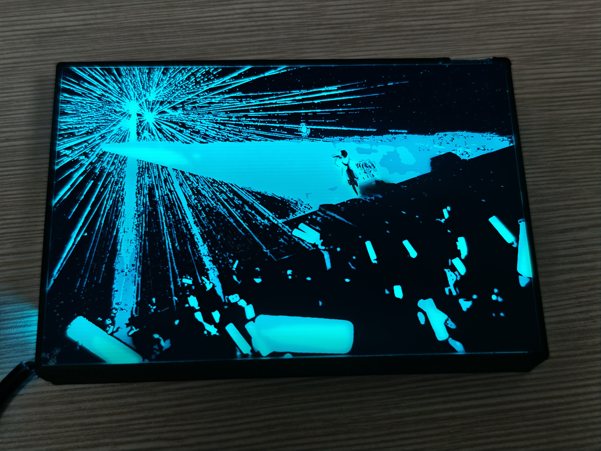
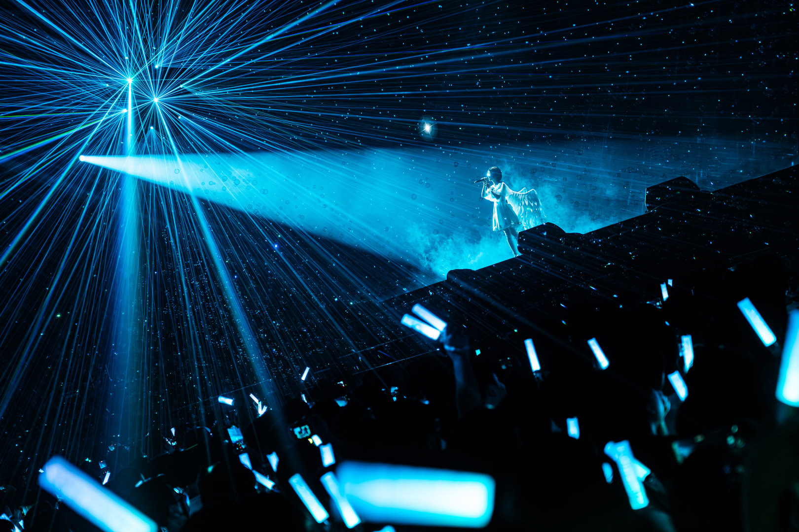
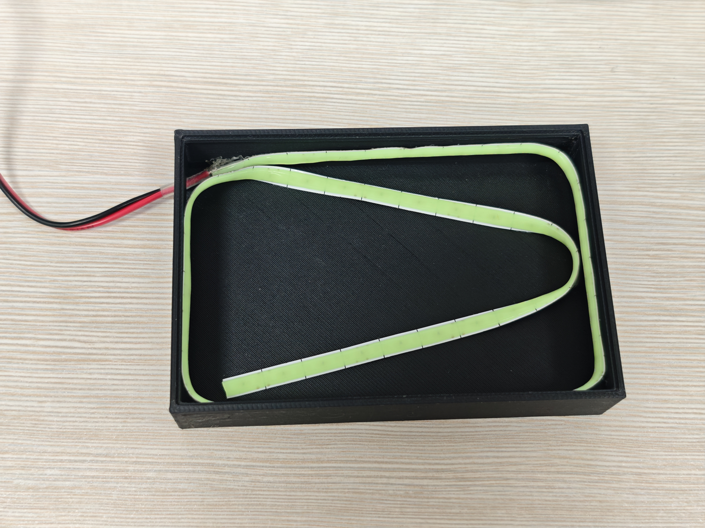
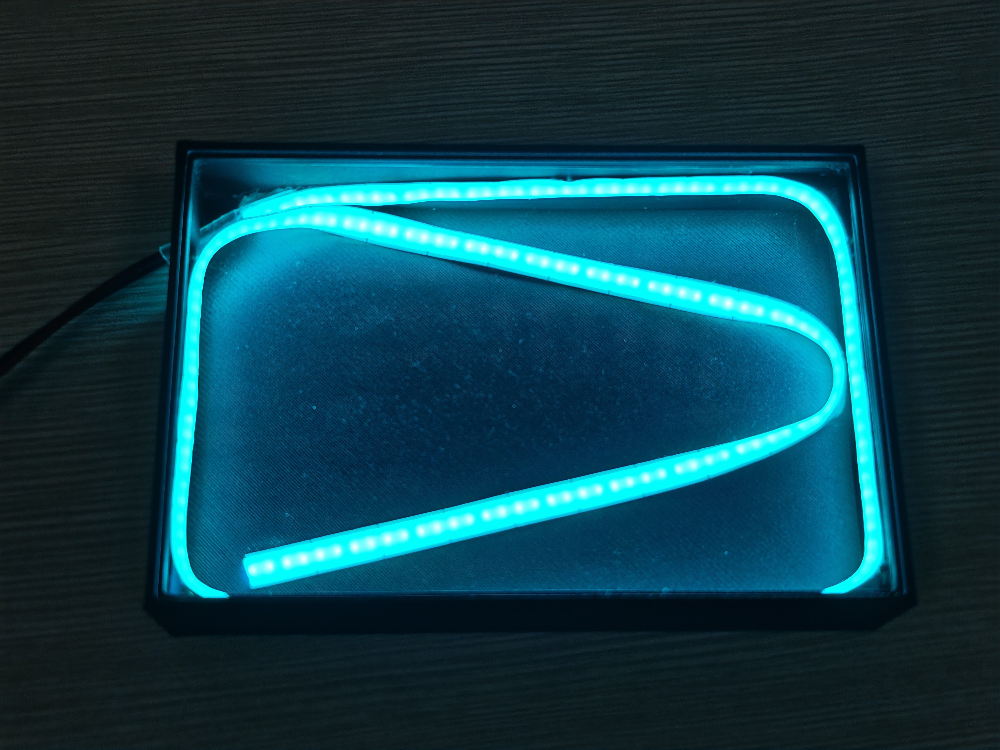

# hanser《它像一颗》透光 PCB 灯盒

将 hanser「花生与葱花」演唱会《它像一颗》的舞台画面制作成透光 PCB，配合 3D 打印灯盒与背光灯带，让光束、人物与荧光棒在背光下呈现出来。
本项目不使用彩色丝印，可按嘉立创免费券的适用规则下单。

## 透光原理

通过铜层和蓝色阻焊的组合，画面呈现四种透光层次：

| 透光效果 | 图层组合 |
| --- | --- |
| 不透光 | 铜层（顶层与底层） |
| 较暗蓝色 | 无铜，两层蓝色阻焊 |
| 较亮蓝色 | 无铜，一层蓝色阻焊 |
| 最亮 | 无铜、无阻焊，露出基板 |

## 项目内容

- [嘉立创 EDA 专业版完整工程](hardware/hanser-PCB.epro2)
- [各层原图压缩包](artwork/各层原图.zip)：包含顶层铜、底层铜、顶层丝印、两面阻焊开窗图和定位说明。
- [灯盒 STEP 模型](lightbox/pcb灯盒.STEP)：用于导入 CAD 或切片软件，检查尺寸并准备 3D 打印。
- [演唱会原图](photos/effa7dcb7069249811b6701d7084b046.png)及 [PCB 正面](photos/pcb正面.jpg)、[PCB 背面](photos/pcb反面.jpg)。
- [灯带布置](photos/灯带布线示意.jpg)、[灯带点亮](photos/灯带布线示意-点亮.jpg)与[室内白光效果](photos/在室内使用白光的效果.jpg)。

## 打开 PCB 工程

使用嘉立创 EDA 专业版导入 `.epro2`。工程内包含三个 PCB 文档，建议打开 **它像一颗_1020**；`它像一颗_1020_反向(实物实际没有区别，就用1020那个)` 和 `它像一颗(废案)` 保留在原工程内，便于查看设计记录。工程内部名称显示为「小天使pcb」，这是原工程的名称。

分层原图包与工程为分别提供的资料；正式打样请以打开的 PCB 工程及导出生产文件为准。底层原图文件名标注「统一正面方向」，导入底层时应检查镜像及前后套准，避免再次误镜像。

## 嘉立创下单

| 参数 | 本项目 |
| --- | --- |
| 文件 | 打开 `它像一颗_1020`，一键下单或导出 Gerber ZIP |
| 成品板厚 | **0.8 mm** |
| 阻焊颜色 | **蓝色** |
| 板层、板框和尺寸 | 按所选 PCB 工程和工厂解析结果核对 |
| 客编 | 可要求放在 **PCB 背面底层铜面**，避开透光画面；位置和实现方式需与工厂确认 |
| 其他工艺 | 按工程原始设计及工厂审核结果核对，不随意修改图案层 |

1. 在专业版打开 `它像一颗_1020`，用 2D/3D 检查板框、正反面铜层和阻焊开窗。透光效果取决于两面图形的组合，不要将所有开窗当作钻孔。
2. 点击「下单 → PCB 下单」，或「导出 → PCB 制板文件（Gerber）」后将完整 ZIP 上传到[嘉立创](https://www.jlc.com/)。
3. 在下单页面选择 **0.8 mm、蓝色阻焊**，核对解析出的层数、尺寸、板框及图层。请勿直接沿用默认板厚或阻焊颜色。
4. 客编选择指定位置，并备注：「客编请放在 PCB 背面底层铜面，避开透光图案；请先确认具体位置、图层和生产效果。」是否需要在对应层放置占位符、如何在铜面实现，以工厂审核和当前规则为准。嘉立创的[客编说明](https://m.jlc.com/portal/q1i19110.html)介绍了阻焊层指定位置的做法，铜面方案应另行确认。
5. 查看工厂生产稿与报价，重点检查双面图案套准、客编位置及透光区域，确认后再付款。

没有附带已验证的 Gerber：请从工程自行导出并确认。图片显示的金属外观不能用于确定具体表面处理，相关选项请按实际打样设计或与工厂核对。

## 灯盒与灯带组装

使用**冰蓝色灯带**，宽 **5 mm**，工作电压 **5 V**，长度约 **40 cm**。实际长度可根据灯盒内部布置和灯带的可裁剪位置调整。

1. 用能读取 STEP 的 CAD 或切片软件打开 [pcb灯盒.STEP](lightbox/pcb灯盒.STEP)，确认模型单位和尺寸与实际 PCB 相符，再按打印设备准备切片和打印。
2. 参考下图，将灯带沿灯盒内部边缘和中部弯折布置，并固定。接入与灯带相匹配的 5 V 电源；接线极性和电源电流容量以所购灯带的规格为准。
3. 先单独测试灯带，再将 PCB 装入灯盒，调整灯带位置，观察背光均匀度。照片展示了蓝青色背光及室内白光下的效果，具体效果取决于灯带和环境。

## 参考与素材

设计参考：[立创开源硬件项目 star-pcb-drawing](https://oshwhub.com/sytnocui/star-pcb-drawing)。感谢原项目的创作者。

舞台画面、演唱会和人物相关权利归各自权利人所有。仓库用于项目展示与交流；引用、二次使用或商业用途请自行确认素材授权。本仓库未额外指定统一许可证。
